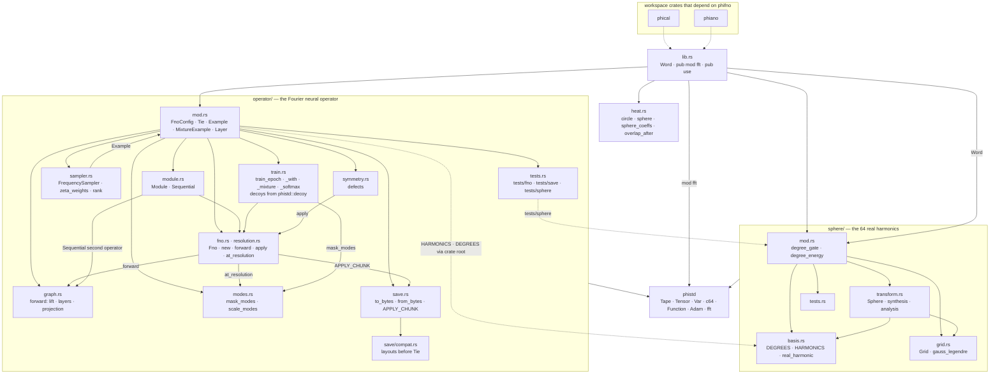
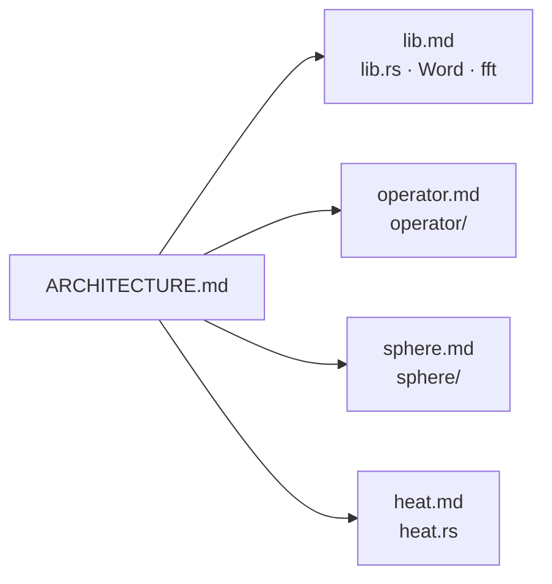

# phifno — architecture

## The crate, module by module

## The module pages

| diagram | file |
|---|---|
| the crate root, Word, fft | [docs/phifno/lib.md](../../docs/phifno/lib.md) |
| the Fourier neural operator | [docs/phifno/operator.md](../../docs/phifno/operator.md) |
| the sphere and its harmonics | [docs/phifno/sphere.md](../../docs/phifno/sphere.md) |
| heat flow on the circle | [docs/phifno/heat.md](../../docs/phifno/heat.md) |

## Status

2026-10-27 · 24 test functions · what is left: [TODO.md](TODO.md)
