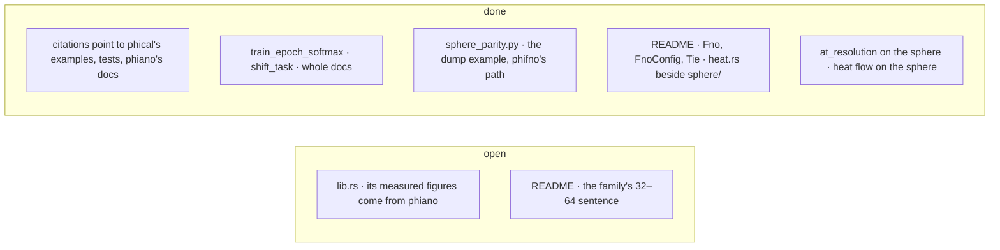

# phifno — TODO

## lib
- [x] The crate doc points to phical's `filter` example and `degree_filter_task` in `operator/tests/sphere.rs`.
- [ ] The crate doc's measured figures come from phiano `bin/operator_sweep`: no test or example in phifno reproduces them.
- [x] `docs/173` is phiano's round doc (`crates/phiano/docs/173_one_fourier_address.md`): not a defect.

## operator
- [x] `at_resolution` points to phical's `ranges` example; `to_bytes_compact` to `tests/save.rs`, which bounds the drift.
- [x] `Fno::at_resolution` (now `operator/resolution.rs`) moves an operator on the sphere too: the groups both resolutions share carry over, `space` may be any perfect square; tested 64 → 16 → 64 and 36.
- [x] `train_epoch_softmax` has a whole doc: what it scores, what it returns.
- [x] `shift_task` in `tests/save.rs` has its own doc.
- [x] `docs/76–78`, `153`, `154` are phiano's round docs (`crates/phiano/docs/`): not a defect.

## sphere
- [x] `sphere_parity.py` runs `-p phifno --example dump` and names `phifno::sphere::real_harmonic`.

## heat
- [x] heat.rs's doc says the sphere's band-limited flow is not built.
- [x] Heat flow on the sphere: `sphere_coeffs` decays degree `l` by `exp(−l(l+1)t)`, `sphere` runs it on grid values; tested.

## README
- [x] The README names the operator half by `Fno`, `FnoConfig`, `Tie`.
- [ ] The paradigm sentence every crate opens with says a word is 32–64 relations; `Word::new` takes exactly 64. Left as written: it is the family's sentence, not phifno's.
- [x] The README puts `heat.rs` beside `sphere/`, on the circle.
